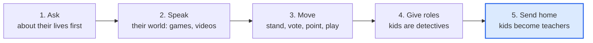
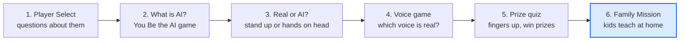
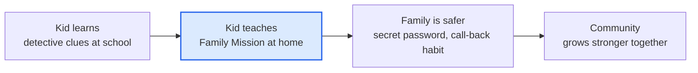

# AI Literacy for Kids and Families

**AI and cyber safety for kids in grades 3 to 5 and the families who support them**

Materials available in English, Español, and Português.

AI Literacy for Kids and Families is a 30-minute, hands-on session created by Dr. Michelle Angelo-Rocha for the Great American Teach-In. Kids learn to spot fake pictures, videos, and voices, protect their personal information, and think like a detective before they believe, click, or share.

---

## Vision

Every child grows up able to question what they see, hear, and read online, and confident enough to teach their family to do the same.

Children today are growing up with AI all around them, in their games, speakers, phones, and videos. This program treats kids as capable thinkers, not passive users. The goal is not to make children afraid of technology. The goal is to help them stay curious, careful, and kind, and to see themselves as future problem solvers in cybersecurity and technology.

## Why this matters right now

Today's elementary students are the first generation growing up with AI from the start. For them, a talking speaker, an AI character in a game, or a computer-made video is simply normal. That makes this the right moment to teach them how to think about it.

| Why now | What it means for kids |
|---|---|
| **Fakes look real.** AI can now make pictures, videos, and voices that fool adults. | Kids can no longer trust their eyes and ears alone. They need clues and questions. |
| **Voices can be copied.** A short recording is enough to copy someone's voice. | Families need simple habits, like a secret password, to stay safe. |
| **Kids are online earlier.** Games, tablets, and chats reach children before they have safety skills. | Strangers and scams can reach them where they play. |
| **AI is in their homework.** Chatbots give answers in seconds, and sometimes the answers are wrong. | Kids need to keep their own thinking strong and know AI can make mistakes. |
| **Families are still learning too.** Many parents and grandparents are new to AI. | When kids teach their families, everyone gets safer together. |

**Habits form early.** The questions children learn to ask at 8, 9, and 10 years old, like "Who made this?" and "Is this real?", become the habits they carry into their teens and adult lives.

**The future workforce starts here.** The same curiosity that helps a child spot a fake video is the curiosity that cybersecurity and AI careers need.

## The bigger picture: why some kids are more vulnerable

The same tools that make AI fun can be used to hurt children. Deepfakes, copied voices, and online strangers do not affect every child the same way.

| Risk | What it can look like for kids |
|---|---|
| **Deepfakes used to bully** | Fake pictures, videos, or voices of classmates, shared to embarrass or humiliate them |
| **Kids as targets** | Strangers in games and chats who try to win a child's trust, and voice scams aimed at their families |
| **Mental health** | Shame, anxiety, and isolation, and children staying silent because they fear getting in trouble |

**The harm reaches the whole family.** When a child is bullied with a fake image or a family is targeted by a copied voice, parents feel fear, stress, and helplessness too. Families already facing hard circumstances may not know where to turn, or may feel shut out when help is offered only in English.

**That is why AI and cyber literacy must include parents and families.** When parents learn alongside their children, in their own language, they can spot warning signs, talk openly at home, and support each other.

## Connection to my research

This work builds on my dissertation research with emergent multilingual immigrant families in Florida public schools.

- **Bullying was common,** and much of it was connected to language and immigration. New technology can make that bullying faster, more public, and harder to stop.
- **Mothers told me schools use a lot of technology, but not with multilingual communities in mind.** Parents want to be involved in their children's education, yet many feel excluded because information reaches them only in English.
- **Families already facing hard circumstances carry more risk.** When a family is navigating immigration, language barriers, bullying, or a child's disability, an online threat can land harder and help can be harder to reach.

**What this means for this program:**
- Teach kindness alongside safety, so children learn never to use technology to hurt others.
- Make "telling is not tattling" a clear message, so children feel safe asking for help.
- Bring families into the learning, with materials in English, Spanish, and Portuguese.
- See families as partners with knowledge and strengths, not as people to be rescued.

## How to reach students: a strategy for educators

| Step | Strategy | What it looks like |
|---|---|---|
| 1 | **Start with them** | Open with questions about their lives: games, languages, devices, dreams. |
| 2 | **Speak their world** | Use video game language: levels, missions, heroes. Use examples they know. |
| 3 | **Move, don't lecture** | Every few minutes, kids stand, point, or vote with their fingers. |
| 4 | **Give them a role** | Kids are detectives, not targets. A role builds confidence instead of fear. |
| 5 | **Send them home as teachers** | A Family Mission turns one lesson into a family conversation. |

**Three things to protect in every session:**
- **Their thinking.** AI is never a shortcut for homework. The brain is the boss.
- **Their kindness.** Never make fakes of others. Telling an adult is being a hero, not tattling.
- **Their time to play.** Fewer slides, more conversation.

## How a session flows

## What I learned teaching 140+ kids

- **Less is more.** Kids learn best with fewer slides and more time to play and talk.
- **Ask about them first.** Questions about their games, languages, and lives get everyone engaged.
- **Use kid words.** Say "think like a detective" instead of "critical thinking."
- **Test every question.** If a grown-up finds a question confusing, kids will too.
- **Be clear about homework.** AI is not for doing your homework for you.

## Learn it, share it

Kids leave as teachers. Each child takes home a Family Mission, so one lesson reaches parents, grandparents, and siblings.

## Acknowledgments

The Stop, Think, Check, Ask pledge is inspired by the national STOP. THINK. CONNECT. online safety campaign.

## License

CC BY 4.0. Free to use and adapt with credit to Dr. Michelle Angelo-Rocha.
